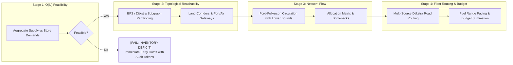

# ScenariGo

> **Interactive Multi-Modal Logistics Scenario Simulation & Discrete Optimization Engine**  
> *Developed by Muhammad Hanif Rafli*  
> Portfolio & Technical Writeup: [https://sinnaungih.vercel.app/post/DUGR5M206gOrZhUFGGNv](https://sinnaungih.vercel.app/post/DUGR5M206gOrZhUFGGNv)

```
[BUILD: PASSING]  [TESTS: 45/45 PASSED]  [ENGINE: PYTHON 3.12 / FASTAPI]  [UI: REACT / TS / LEAFLET]
```

---

## 1. Executive Overview

**ScenariGo** is an interactive web-based discrete optimization engine and supply chain scenario simulator. It models multi-echelon inventory replenishment across geographically partitioned territories—specifically evaluating freight logistics between **Peninsular Malaysia** and **East Malaysia (Sabah & Sarawak)**.

Rather than acting as a simple turn-by-turn vehicle routing GPS, ScenariGo answers strategic **"What-If" Feasibility & Flow Allocation Questions**:

> *"Given current warehouse stocks, store product requests, disconnected regional landmasses, vehicle fuel capacities, and strict transport budget ceilings: Can the supply chain fulfill customer demand? If not, what exact product SKUs are in deficit, which regional subgraphs require intermodal maritime or air transshipment, and how should fleet assets be scheduled without exceeding operating budget?"*



---

## 2. Theoretical Optimization Pipeline

The core decision engine is built from first principles using graph theory and operations research algorithms, strictly decoupled into four sequential stages:

### Stage 1: Global Feasibility Check ($O(N)$ Early Cutoff)
- Calculates aggregate supply $\sum_{w} \text{Supply}(w, p)$ versus aggregate demand $\sum_{s} \text{Request}(s, p)$ for every SKU $p$.
- **Early Cutoff Principle**: If any SKU exhibits a global deficit, execution terminates immediately. The engine emits actionable mathematical audit tokens disclosing the exact shortfall:
  ```
  [FAIL: INVENTORY DEFICIT] Product P1 short by 10 units. Requested = 50, Available = 40 [INFEASIBLE]
  ```

### Stage 2: Topological Reachability & Subgraph Partitioning
- Analyzes the multi-modal transport network using breadth-first search and Dijkstra shortest paths.
- Partitions destination stores into **Land-Reachable Subgraphs** versus **Isolated Island Nodes** requiring intermodal maritime shipping fairways or expedited air freight corridors.
- **Anti-Naive-Chord GIS Invariant**: All land edges snap to real highway coordinates (OSRM / Federal Route geometries). Maritime shipping fairways strictly circumvent landmasses in deep international waters (clearing Tanjung Datu at latitude $\ge 2.40^\circ\text{N}$).

### Stage 3: Multi-Commodity Residual Flow (Circulation with Demands & Lower Bounds)
- Formulates multi-echelon replenishment as a circulation network with lower bounds:
  - Store demand is enforced as a strict lower bound: $[\text{Demand}(s, p), \text{Demand}(s, p)]$.
  - Warehouse stock is constrained by capacity upper bounds: $[0, \text{Stock}(w, p)]$.
  - Intermodal port gateways impose throughput caps: $[0, \text{ThroughputCapacity}]$.
- Solves via **Ford-Fulkerson with Super-Source ($S^*$) and Super-Sink ($T^*$) demand transformation**, producing an exact allocation matrix $\mathbf{A}[w, s, p]$ and isolating bottleneck saturations.

### Stage 4: Vehicle Tour, Fuel Range Pacing & Budget Optimization
- Routes delivery dispatches from warehouse base stations using **Multi-Source Dijkstra**.
- Verifies physical vehicle range against fuel tank capacities:
  $$\text{Fuel Required} = \frac{\text{Path Distance (km)}}{\text{Fuel Economy (km/L)}} \le \text{Tank Capacity (L)}$$
- Evaluates total operational expense across road diesel, maritime vessel container tariffs, and air cargo fees:
  $$\text{Total Cost} \le \text{Budget Cap (MYR)}$$

---

## 3. System Architecture & Tech Stack

```
ScenariGo/
├── codebase/
│   ├── backend/               # FastAPI Python 3.12 Discrete Optimization Service
│   │   ├── app/
│   │   │   ├── api/v1/        # REST Endpoints (/feasibility, /reachability, /flow, /fleet, /scenarios)
│   │   │   ├── core/          # Mathematical Algorithms (Stages 1 - 4)
│   │   │   ├── db/            # SQLite Persistence & Factory Preset Seeding
│   │   │   ├── models/        # Pydantic Schemas (Entities, Graph, Responses)
│   │   │   └── data/          # Malaysia Road Network & Maritime Coordinates
│   │   └── tests/             # Pytest Comprehensive Test Suite (45 Tests)
│   │
│   └── frontend/              # Vite + React + TypeScript + Tailwind CSS UI
│       ├── src/
│       │   ├── pages/         # DashboardPage, OrganizationPage, ManageFleet, GraphView
│       │   ├── components/    # MapView, DashboardHealthMap, LocationPickerMap, Stage Panels
│       │   ├── services/      # REST API Client & CSV Parsers (Papaparse)
│       │   └── types/         # TypeScript Interfaces
│       └── public/            # Commercial Fleet Photography & GIS Assets
│
└── specs/                     # Technical Specifications & System Design
```

### Technology Matrix
- **Backend API & Optimization Core**: Python 3.12, FastAPI, Pydantic v2, Uvicorn, SQLite3.
- **Frontend Visualization & UI**: Vite, React 18, TypeScript, Tailwind CSS, React-Leaflet (`Leaflet.js`), Lucide Icons.
- **GIS Cartography**: OpenStreetMap with dark monochrome CSS inversion filter, high-contrast chromatic network arcs (Amber = Highway, Cyan = Maritime Fairway, Purple = Flight Corridor).
- **Quality & Testing**: Pytest, Ruff linting, TypeScript strict mode (`tsc -b`).

---

## 4. Key Interactive Capabilities

### 1. Operational Health Dashboard (`DASHBOARD` View)
- Real-time KPI Ribbon: Fulfillment Rate (%), Retail Shortfalls, At-Risk Warehouse Stock, Active Dispatches, and Transport Budget consumption.
- 3D Granularity Toolbar: Filter by Region (`Global`, `Peninsular`, `Borneo`), Product SKU (`P0`, `P1`, `P2`), and Health Status (`All`, `At-Risk Only`).
- **Spatial Facility Health Map & Dependency Tethers**: Interactive Leaflet map displaying warehouse reserve gauges and store fulfillment status. Clicking any node draws dynamic chromatic tether arcs to all supplying or destination facilities.

### 2. Organization Master Data Console (`ORGANIZATION` View)
- **Scenarios & Data Sources**: Switch between built-in industrial presets (`Bob's Stationery Baseline`, `East Malaysia Stockout`, `Expedited Air Freight`, `Tri-Port Multi-Gateway Logistics`) with 1-click **Reset to Factory Baseline**.
- **Interactive Facility CRUD**: Add or edit warehouses and retail stores using the **Location Picker Map** with drag-and-drop coordinate snapping.
- **Master Product Catalog**: Configure product SKUs, unit weights (kg), and low-stock alert thresholds.
- **Commercial Fleet Assets**: Configure vehicle models (Isuzu 3-Ton, Tata Ace), payload capacities, fuel economies, and base stations.

### 3. 60fps Commercial Fleet Vehicle Animation (`SIMULATOR` View)
- Real-time physics-interpolated animated truck pins traversing actual Malaysian highway polylines (E1/AH2, Federal Route 2, Pan-Borneo Highway) with deadhead return repositioning.

---

## 5. Quickstart Guide (Local Development)

### Prerequisites
- Python 3.11+ (Python 3.12 recommended)
- Node.js 18+ and `npm`

### 1. Clone Repository
```bash
git clone https://github.com/hanif-rafli/ScenariGo.git
cd ScenariGo
```

### 2. Start Backend Service
```powershell
cd codebase/backend
python -m venv .venv
.venv\Scripts\activate       # On Linux/macOS: source .venv/bin/activate
pip install -e ".[dev]"
uvicorn app.main:app --port 8000 --reload
```
*Backend API documentation available at `http://localhost:8000/docs`.*

### 3. Start Frontend UI
```powershell
# Open a new terminal
cd codebase/frontend
npm install
npm run dev
```
*Open `http://localhost:5173` in your browser.*

### 4. Run Test Suite
```powershell
# Backend unit & integration tests
cd codebase/backend
pytest -v

# Frontend TypeScript compilation & build verification
cd codebase/frontend
npm run build
```

---

## 6. Design System & Style Invariants

- **Pitch-Black Foundation**: High-contrast `#000000` pitch-black background with crisp white typography and monospace numerical telemetry (`font-mono`).
- **Chromatic Map Differentiation**: High-contrast modality arcs (Amber `#f59e0b` for Highways, Light Blue `#38bdf8` for Sea Fairways, Purple `#c084fc` for Air Corridors, Red `#ef4444` for Flow Deficits).
- **Strict No-Emoji Policy**: Clean, professional text badges (`[OK]`, `[DEFICIT]`, `[HEALTHY]`, `[LOW STOCK]`) or vector SVG iconography.
- **Zero-Fluff Standard**: Every visual component directly reflects physical supply chain metrics—zero decorative filler.

---

## 7. License & Credits

Developed by **Muhammad Hanif Rafli**. Released under the [MIT License](LICENSE).
