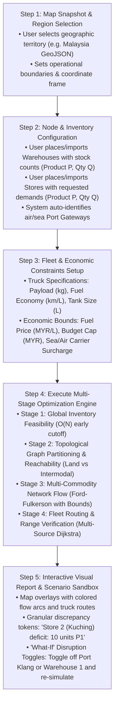
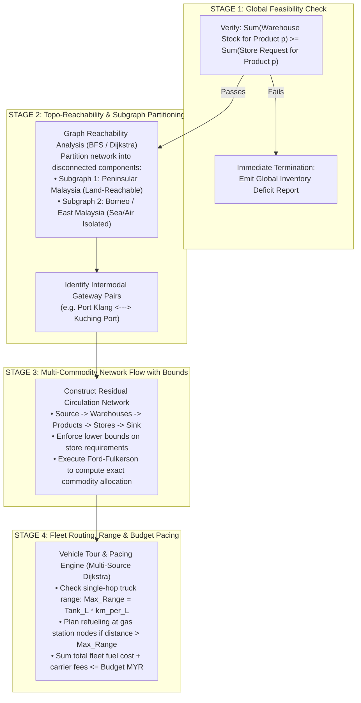
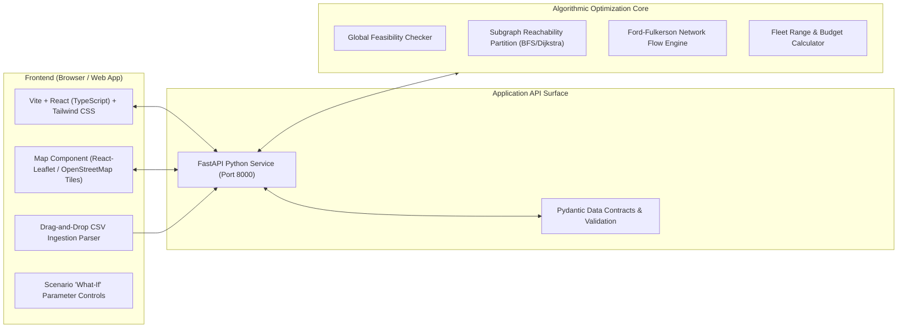

# ScenariGo — Technical Specification & System Architecture
## Interactive Multi-Modal Logistics Scenario Simulation & Discrete Optimization Engine

> **Project Lead & Author**: Muhammad Hanif Rafli (Hanif)  
> **Status**: Active Architectural Specification (Version 1.0)  
> **Historical Notes**: Migrated from `docs/old-specs/Specs.txt`  
> **Author Portfolio Reference**: [Hanif's Technical Post](https://sinnaungih.vercel.app/post/DUGR5M206gOrZhUFGGNv)

---

## 1. Upstream Context & Domain Foundations

ScenariGo brings together discrete combinatorial optimization, operations research, and Malaysian freight forwarding logistics realities:

| Engineering Domain | Primary Principles & Capabilities Applied | Context / Reference |
| :--- | :--- | :--- |
| **Container Freight & Port Intelligence** | Ground-level domain knowledge on Malaysian container gateways (Port Klang Westports, Port of Tanjung Pelepas Johor, Butterworth), domestic cabotage, and intermodal sea/air transshipment delays. | Logistics Trade Architecture |
| **Resilience & Verified Engineering** | Multi-stage verification pipeline, deterministic audit tokens over opaque badges, and zero-fluff telemetry. | Sergio's Playbook |
| **Combinatorial Discrete Optimization** | Circulation with demands and lower bounds via Ford-Fulkerson, linked-list residual networks, and multi-source Dijkstra road routing. | Operations Research Principles |
| **Decoupled Architecture** | Four-stage sequential deterministic floor decoupled from UI visualization and animated layers. | System Design Standard |

---

## 2. Executive Product Concept & The User Case Study

### 2.1 What is ScenariGo?
ScenariGo is an **interactive web-based discrete optimization and supply chain simulation sandbox**. It models multi-echelon inventory replenishment across geographically partitioned territories (specifically Peninsular Malaysia vs East Malaysia / Sabah & Sarawak). 

Rather than functioning as a real-time turn-by-turn truck navigation GPS, ScenariGo solves the strategic **"What-If" Feasibility & Network Flow Problem**:
> *"Given current warehouse stocks, store product requests, disconnected regional islands, vehicle fuel and payload constraints, and a fixed operational budget: Can my supply chain fulfill demand? If not, what exact products are in deficit, which regional subgraphs require intermodal sea/air transshipment, and how should my fleet be dispatched to stay within budget?"*

### 2.2 The Anchor Case Study: "Bob's Stationery Enterprise"
- **Business Profile**: Bob operates a manufacturing and distribution company based in Kuala Lumpur, Malaysia.
- **Physical Footprint**:
  - Factories and primary warehouses are located in Peninsular Malaysia (e.g. KL, Kajang, Ipoh, Butterworth).
  - Retail outlets, supermarkets, and customer stores are distributed across Peninsular Malaysia and East Malaysia (Kuching, Kota Kinabalu, Sandakan).
- **Fleet & Carrier Setup**:
  - Owns a fleet of regional delivery trucks (e.g. Tata Ace Gold: 900 kg payload, 22 km/L fuel economy, 26 L fuel tank capacity).
  - Trucks are stationed at specific warehouse locations.
  - Domestic intermodal sea/air shipping partners connect West Malaysia (Port Klang / Penang Port) to East Malaysia (Kuching Port / Kota Kinabalu Port).
- **Core Dilemma**:
  Bob faces operational budget limits (e.g. MYR 7,000 maximum transport budget per cycle) and needs to evaluate:
  1. *Global Feasibility*: Do all warehouses combined hold enough inventory to cover all store requests?
  2. *Regional Feasibility*: Can store requests in Peninsular Malaysia be satisfied purely over land?
  3. *Intermodal Transshipment*: Which products must be routed to seaports/airports for cross-strait movement to East Malaysia?
  4. *Fleet Dispatch*: How many trucks must run, what are their pickup-dropoff sequences, and will they run out of fuel or exceed budget?

---

## 3. High-Level Usage Flow & User Experience



---

## 4. Multi-Stage Algorithmic Architecture

The engine operates in four decoupled, sequential stages. This prevents combinatorial explosion and avoids naive NP-hard formulation traps:



### 4.1 Stage 1: Global Feasibility (Early Termination)
- Compares aggregate warehouse supply against aggregate store demand across all product IDs:
  $$\forall p \in \mathcal{P}: \quad \sum_{w \in \mathcal{W}} \text{Inventory}(w, p) \ge \sum_{s \in \mathcal{S}} \text{Request}(s, p)$$
- If any product exhibits a global deficit, execution halts immediately with an explicit audit token:
  `Product P0 deficit: Requested = 30, Available = 25. Shortfall = 5 units [INFEASIBLE]`.

### 4.2 Stage 2: Topological Reachability & Subgraph Partitioning
- The physical road network is represented as a multigraph $G = (V, E)$, where edges carry transport modalities:
  - $\text{type} = 0$: Land road (traversable by trucks).
  - $\text{type} = 1$: Maritime sea lane (requires ocean carrier / port-to-port).
  - $\text{type} = 2$: Air freight corridor (requires airport-to-airport).
- Runs BFS / Dijkstra from each warehouse over land edges ($\text{type} = 0$) to identify the set of directly land-reachable stores.
- If a store requests product $p$ and no land-reachable warehouse stocks $p$, the engine flags the requirement for intermodal transshipment via the nearest designated departure and arrival ports.

### 4.3 Stage 3: Multi-Commodity Network Flow (Ford-Fulkerson with Bounds)
- Evaluates whether products can be routed through capacitated logistics channels without violating warehouse stock or store requirements:
  1. **Source to Warehouse Layer**: Capacity equal to total warehouse stock $\sum_p \text{Inventory}(w, p)$.
  2. **Warehouse to Product Layer**: Bounded capacity matching specific product stock $[0, \text{Inventory}(w, p)]$.
  3. **Product to Store Layer**:
     - Direct edges for land-reachable pairs.
     - Port-intermodal edges for cross-water pairs (with transshipment throughput limits).
  4. **Store to Sink Layer**: Lower bound and capacity matching exact store demand $[\text{Request}(s, p), \text{Request}(s, p)]$.
- Uses circulation with demands and a super-source/super-sink to resolve lower bounds and strictly fulfill non-negotiable retail demand constraints.
- **Output**: An exact allocation matrix $\mathbf{A}[w, s, p]$ specifying the quantity of product $p$ dispatched from warehouse $w$ to store $s$.

### 4.4 Stage 4: Fleet Routing, Range & Budget Verification
- Given the allocation matrix $\mathbf{A}[w, s, p]$:
  - Clusters deliveries per warehouse and assigns available trucks stationed at that warehouse.
  - Computes shortest road travel paths using Multi-Source Dijkstra.
  - **Fuel & Range Constraint**:
    $$\text{Single Hop Fuel Used} = \frac{\text{Distance (km)}}{\text{Fuel Economy (km/L)}}$$
    $$\text{If } \text{Fuel Used} > \text{Tank Capacity (L)}, \quad \text{must route via intermediate fuel station node.}$$
  - **Budget Constraint**:
    $$\text{Total Cost} = \sum_{\text{trucks}} (\text{Fuel Burn} \times \text{Fuel Price}) + \sum_{\text{intermodal}} \text{Carrier Surcharge} \le \text{Budget}_{\max}$$

---

## 5. Software Architecture & Technology Stack

To ensure professional portfolio demonstration and rapid stakeholder review, ScenariGo is architected as a lightweight, modular web application:



### 5.1 Technology Selection Justification

| Component | Selected Stack | Architectural Justification |
| :--- | :--- | :--- |
| **Frontend Framework** | **Vite + React + TypeScript** | High responsiveness, zero-install instant browser load, static typing. |
| **Map Rendering** | **React-Leaflet (`Leaflet.js`)** | Lightweight, open-source, uses standard OpenStreetMap tiles, renders GeoJSON country shapes and custom markers with zero licensing fees. |
| **Data Ingestion** | **Papaparse (Browser CSV Parser)** | Allows drag-and-drop of `warehouses.csv` and `stores.csv`, eliminating tedious manual coordinate entry. |
| **Backend API** | **FastAPI (Python 3.12)** | Asynchronous, auto-generates OpenAPI documentation (`/docs`), seamless integration with Python graph algorithms. |
| **Optimization Core** | **Custom Python Algorithms** | Implements Ford-Fulkerson, linked-list residual graphs, and Dijkstra from first principles without black-box third-party solvers. |
| **Deployment Target** | **Vercel (UI) + Render / Fly.io (API)** | Accessible via public HTTPS URL on any desktop or mobile device. |

---

## 6. Engineering Protocol: What to Prioritize vs What to Avoid

Following the Three-Tier Engineering Protocol and Sergio's architectural advice:

### 6.1 What to Prioritize (Core Engineering Value)
1. **Actionable Explainability Over Opaque Statuses**:
   - Never display a generic failure like `[SIMULATION FAILED]`.
   - Output explicit, actionable tokens:
     - `[FAIL: INVENTORY DEFICIT] Product P1 short by 10 units at Store S2 (Kuching).`
     - `[FAIL: RANGE EXCEEDED] Truck T1 requires 32L fuel to reach Store S4 from Warehouse W0, exceeding 26L tank limit. No intermediate fuel station found on route.`
     - `[FAIL: OVERBUDGET] Total transport cost MYR 7,850 exceeds budget cap of MYR 7,000 (+MYR 850 overage).`
2. **Preset Sample Scenarios (One-Click Demos)**:
   - Provide pre-loaded demo buttons:
     - **Button A: "Clean Baseline"** (All stores fulfilled within MYR 5,200).
     - **Button B: "Haze Disruption"** (Port Klang closed; shifts traffic to Penang Port).
     - **Button C: "East Malaysia Stockout"** (Forces intermodal transshipment).
3. **Data Ingestion Pipeline**:
   - Support standard `.csv` upload with clean format validation and user-friendly error messages if columns are missing.

### 6.2 What to Strictly Avoid (Scope Creep Traps)
- **NO Desktop Pygame / PyQt Builds**: Do not spend time debugging local GUI event loops. Web delivery is mandatory for portfolio visibility.
- **NO "No-Dictionary" Constraints in the Web Layer**: While the mathematical core (`core_flow.py`) can use array-based linked-list structures for algorithmic purity, the FastAPI surface and web frontend must use standard dictionaries, JSON objects, and Pydantic models.
- **NO Full CVRPTW NP-Hard Solvers**: Do not attempt to solve dynamic ad-hoc vehicle detours with multi-stop partial drop combinatorics on day one. Stick to decoupled Allocation (Flow) $\to$ Dispatch (Shortest Path).
- **NO Heavy PostGIS / GeoServer Infrastructure**: Avoid setting up heavy spatial database engines. Standard GeoJSON coordinates and Haversine / Openrouteservice road distance matrices are completely sufficient.
- **NO Micro-Traffic & Toll Modeling**: Exclude road tolls, bridge fees, and minute-by-minute traffic jams. Keep the economic model focused on fuel burn and intermodal carrier surcharges.

---

## 7. Data Contracts & CSV Schema Specifications

### 7.1 `warehouses.csv`
```csv
warehouse_id,name,latitude,longitude,is_port,product_id,quantity
0,Kuala Lumpur Hub,3.1390,101.6869,false,0,50
0,Kuala Lumpur Hub,3.1390,101.6869,false,1,30
1,Penang Logistics Dep,5.4164,100.3327,true,0,20
1,Penang Logistics Dep,5.4164,100.3327,true,2,40
2,Kuching Transshipment,1.5533,110.3592,true,1,15
```

### 7.2 `stores.csv`
```csv
store_id,name,latitude,longitude,product_id,requested_qty
0,Shah Alam Retail,3.0738,101.5183,0,25
0,Shah Alam Retail,3.0738,101.5183,1,10
1,Ipoh Supermarket,4.5975,101.0901,0,15
2,Kuching Central Mall,1.5300,110.3400,1,20
2,Kuching Central Mall,1.5300,110.3400,2,10
```

### 7.3 `fleet.json`
```json
{
  "truck_models": [
    {
      "model_id": "tata_ace",
      "name": "Tata Ace Gold",
      "payload_capacity_kg": 900,
      "fuel_economy_kmpl": 22.0,
      "fuel_tank_capacity_l": 26.0
    },
    {
      "model_id": "three_ton_lorry",
      "name": "Isuzu 3-Ton Box Lorry",
      "payload_capacity_kg": 3500,
      "fuel_economy_kmpl": 8.5,
      "fuel_tank_capacity_l": 100.0
    }
  ],
  "economic_parameters": {
    "fuel_price_myr_per_liter": 2.05,
    "intermodal_sea_base_fee_myr": 450.0,
    "intermodal_sea_per_kg_myr": 0.85,
    "default_budget_cap_myr": 7000.0
  }
}
```

---

## 8. Open Architectural Questions for Hanif

Before kicking off implementation of the visual web frontend and API endpoints, consider these three design decisions:

1. **Map Engine Choice**:
   - *Option A (Recommended)*: **React-Leaflet** with standard OpenStreetMap tiles. Zero API keys, completely free, renders custom SVG markers and polyline flow paths with high performance.
   - *Option B*: **Mapbox GL / MapLibre**. Provides slick vector maps and 3D terrain, but requires Mapbox API tokens and setup.
2. **Road Distance Calculation**:
   - *Option A (Deterministic Offline)*: Pre-computed distance matrix between Malaysia's 20 primary logistics hubs (instantaneous, zero external API dependencies, offline-first).
   - *Option B (Live Routing)*: Integrated with Openrouteservice (ORS) or OSRM public API to fetch real driving road geometry.
3. **Preset Case Studies**:
   - Should we package the Bob Stationery scenario as the default built-in dataset so anyone opening the web app can click "Run Scenario" without uploading any files?

---
*Specification Compiled & Structured for Technical Execution | ScenariGo Project — Department of Data Science & AI*
